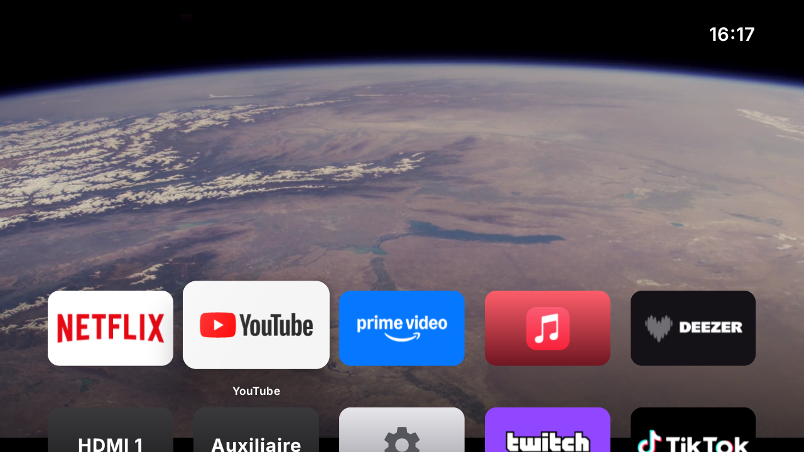
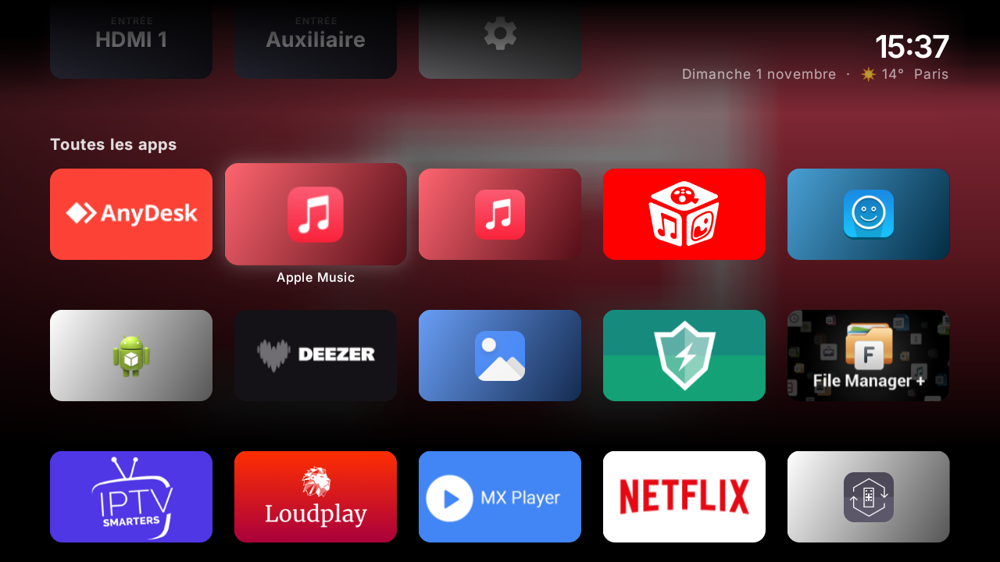
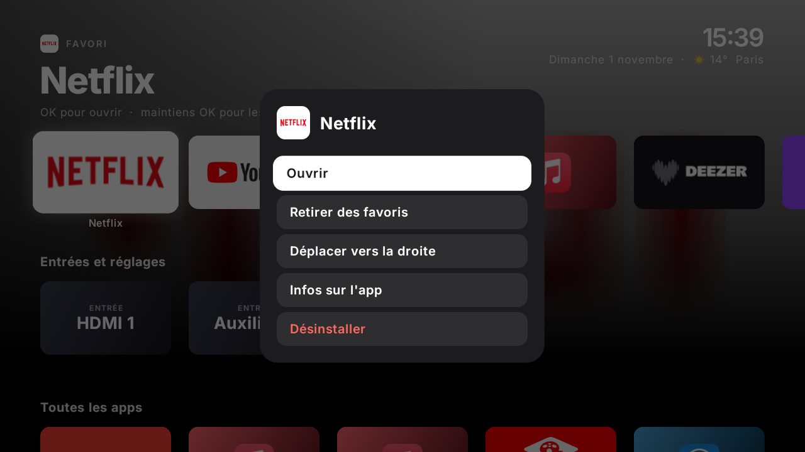
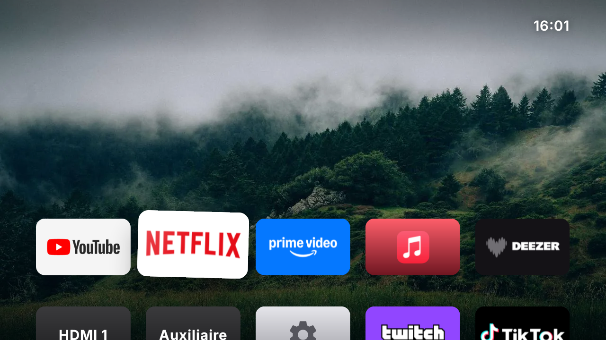
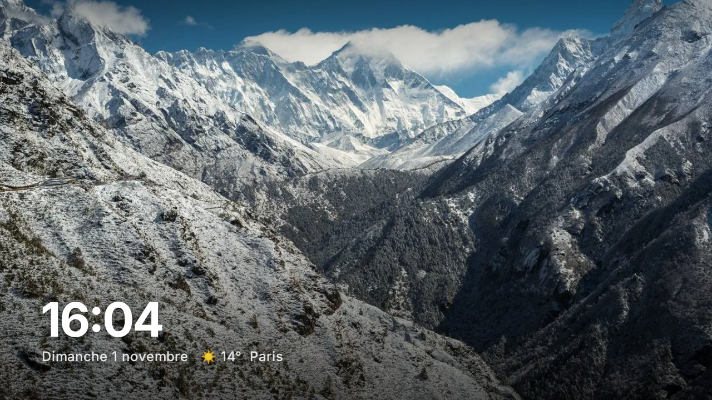
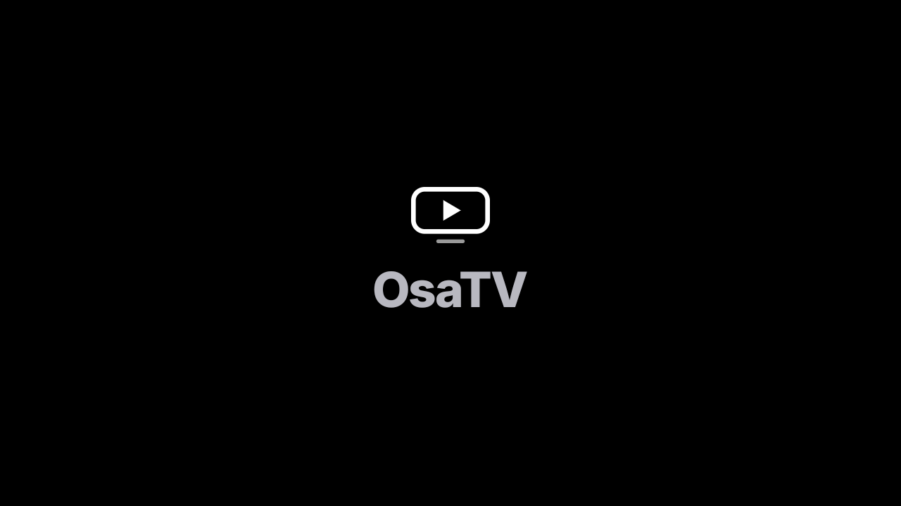

# OsaTV

Un écran d'accueil pour Android TV, inspiré de l'Apple TV. Il remplace l'accueil Google sans root et sans toucher au firmware de la télé.

Il a été développé et testé sur une TCL S6500 (châssis RT41, Android TV 9, 720p, 1,4 Go de RAM).



*Sur YouTube, le haut de l'écran montre la Terre filmée depuis la Station spatiale internationale (vidéo NASA, en direct de la télé).*

| Dans la grille | Appui long sur OK |
|---|---|
|  |  |
| **Mode déplacement** | **Économiseur** |
|  |  |
| **Démarrage** | |
|  | |

## Ce qu'il fait

- **Un démarrage animé** : le logo apparaît, un reflet traverse « OsaTV » sur un petit carillon, puis l'accueil s'ouvre. L'animation couvre le chargement des apps.
- **Le haut de l'écran change selon l'app du dock sous le focus**, comme le « Top Shelf » de tvOS :
  - **Netflix, Prime Video, Disney+** : un carrousel de séries en plein écran (image, titre, genres, année, note, prochain épisode), qui défile tout seul toutes les 8 secondes ;
  - **Deezer, Apple Music, Spotify** : les albums du moment (classement Deezer), sur la pochette floutée ;
  - **YouTube et le reste** : une vidéo de la Terre vue depuis l'ISS, muette, en boucle ;
  - sinon, un paysage en plein écran qui change toutes les 20 secondes.
- **Des sons** : un clic à chaque déplacement, un son de validation, un petit choc quand on bute contre le bord.
- **Une seule grille d'icônes** au format 5:3, comme sur tvOS. La première rangée sert de dock et se pose sur l'image. Les entrées HDMI et les réglages sont des icônes comme les autres.
- **Au focus**, l'icône grossit avec un ressort, se soulève avec une ombre portée et un reflet, et s'incline légèrement depuis le côté d'où l'on arrive. Au bord de la grille, elle rebondit. Son nom n'apparaît que sous elle.
- **En descendant dans la grille**, l'image disparaît vers le haut et le fond devient flou et sombre.
- **Appui long sur OK** : un menu pour déplacer l'icône, voir les infos de l'app ou la supprimer.
- **Mode déplacement** : l'icône tremble et se déplace avec les flèches. OK ou Retour pour la poser. L'ordre est mémorisé.
- **Économiseur** : après 3 minutes sans toucher la télécommande, la grille s'efface. Il reste la vidéo de la Terre vue de l'ISS en plein écran, l'heure, la date et la météo. La première touche réveille l'écran sans rien ouvrir.
- **Bouton Home ou Retour** : retour en haut, sur la première icône.

Au premier lancement, les apps de streaming connues (Netflix, YouTube, Prime Video…) sont placées dans le dock. Une app installée plus tard s'ajoute à la fin de la grille.

## Installer sur une télé

Sur la télé :
1. Ouvre **Paramètres → Préférences de l'appareil → À propos**, puis appuie 7 fois sur **Build**.
2. Dans **Options pour les développeurs**, active le **débogage USB**.
3. Note l'adresse IP de la télé (Paramètres → Réseau).

Sur le Mac, avec `adb` installé (`brew install android-platform-tools`) :

```sh
./scripts/install.sh 192.168.1.XX OsaTV-0.3.0.apk
```

Le script installe l'APK, fait d'OsaTV l'accueil par défaut et désactive l'accueil Google. Sans ça, celui-ci reprend la main sur le bouton Home.

Pour revenir à l'accueil d'origine :

```sh
./scripts/restore.sh 192.168.1.XX
```

Une réinitialisation d'usine de la télé remet aussi tout comme avant.

### Alléger la télé (optionnel)

```sh
./scripts/alleger.sh 192.168.1.XX
```

Désactive 20 apps système qui tournent pour rien : télémétrie et « gardien » TCL, boutique TCL, autocollants du mode magasin, services Google fermés (Play Films, Play Musique, Play Jeux), recommandations et ancien accueil Google, économiseur Google, rapports de bugs, galerie, impression, Chromecast. La liste commentée est dans le script. Netflix, YouTube, Prime Video, le Play Store, l'Assistant et les entrées HDMI ne sont pas touchés.

Sur la TCL S6500, le système réactive Chromecast à chaque redémarrage complet de la télé : il suffit de relancer le script.

Rien n'est supprimé. Pour tout réactiver :

```sh
./scripts/alleger.sh 192.168.1.XX annuler
```

## Compiler

Il faut un JDK 17 et le SDK Android (plateforme 35) :

```sh
brew install openjdk@17
brew install --cask android-commandlinetools
sdkmanager "platforms;android-35" "build-tools;35.0.0"
echo "sdk.dir=/opt/homebrew/share/android-commandlinetools" > local.properties
JAVA_HOME=/opt/homebrew/opt/openjdk@17 ./gradlew assembleRelease
```

L'APK sort dans `app/build/outputs/apk/release/`. La version release est signée avec la clé décrite dans `keystore.properties`, qui n'est pas dans le dépôt. Sans ce fichier, elle est signée avec la clé de debug.

⚠️ Une mise à jour ne s'installe par-dessus l'ancienne version que si elle est signée avec la même clé.

## Technique

- Kotlin + Jetpack Compose, avec [Compose for TV](https://developer.android.com/jetpack/androidx/releases/tv) (`androidx.tv:tv-material`).
- minSdk 28 (Android TV 9).
- L'activité déclare la catégorie `HOME` pour pouvoir servir d'écran d'accueil.
- Le flou du fond n'utilise pas `Modifier.blur`, qui n'existe qu'à partir d'Android 12. L'image est réduite à 32 × 18 pixels puis agrandie avec lissage, ce qui ne coûte presque rien sur une puce d'entrée de gamme.
- Le défilement est piloté à la main (un `translationY` animé, sans conteneur défilant), pour placer chaque rangée au même endroit comme sur tvOS.
- La puce graphique de la télé est modeste, et c'est elle qui limite la fluidité. Ce qui a compté :
  - la vidéo est une `SurfaceView` créée seulement quand elle est visible : sur ce châssis, sa simple présence oblige la télé à recomposer tout l'écran à chaque image ;
  - les fondus appliquent l'opacité à chaque dessin (`CompositingStrategy.ModulateAlpha`, voir `LightCrossfade.kt`) au lieu de passer par un tampon plein écran ;
  - l'ombre des icônes est dessinée une fois dans une image, au lieu d'une ombre calculée à chaque image ;
  - les images sont réduites à la taille de l'écran, gardées sur le disque, et envoyées à la puce graphique en avance (`prepareToDraw`) ;
  - les couches cachées (alpha 0) ne sont pas dessinées.
- Les entrées HDMI viennent de `TvInputManager`. Sur les TCL, il faut ouvrir l'URI passthrough avec le type `vnd.android.cursor.item/channel` : l'app TV de TCL ne répond qu'à ce type.

| Fichier | Rôle |
|---|---|
| `data/Apps.kt` | Liste des apps, bannières, couleurs, favoris |
| `data/Sources.kt` | Entrées HDMI |
| `data/Weather.kt` | Position par IP + météo Open-Meteo |
| `HomeState.kt` | Icônes de l'accueil, ordre, déplacement |
| `ui/HomeScreen.kt` | Grille, défilement, économiseur |
| `ui/Tiles.kt` | Icônes (focus, reflet, tremblement) |
| `data/Showcase.kt` | Séries (TVmaze) et albums (Deezer) du haut de l'écran |
| `data/Images.kt` | Téléchargement, cache disque et flou des images |
| `ui/Shelf.kt` | Haut de l'écran (vidéo, photo, contenu), fond flou, heure |
| `ui/TopShelf.kt` | Carrousel de séries, albums |
| `ui/Aerial.kt` | Vidéo de la Terre |
| `ui/LightCrossfade.kt` | Fondu léger pour la puce graphique |
| `ui/Intro.kt` | Animation de démarrage |
| `ui/Feedback.kt` | Sons, sens de navigation |
| `ui/AppMenu.kt` | Menu de l'appui long |

## Limites

- La télé n'est pas rootée : l'animation de démarrage TCL, les réglages et l'interface des apps (Netflix…) restent ceux d'origine.
- Une mise à jour système TCL peut réactiver l'accueil Google. Il suffit alors de relancer `scripts/install.sh`.
- Sur cette télé, le premier affichage après un redémarrage prend environ 3 secondes, le temps de charger les images des apps (l'animation de démarrage le masque).
- Les séries mises en avant ne viennent pas du compte Netflix/Prime/Disney+ : ces apps ne partagent pas leur catalogue. Ce sont des listes de séries choisies dans `Showcase.kt`, avec les images et les infos de TVmaze.
- Les transitions entre deux apps du dock (changement d'image plein écran) restent un peu moins fluides que le reste sur cette puce.
- Le haut de l'écran a besoin d'Internet. Hors ligne, les séries et albums déjà vus restent en cache ; sinon, ce sont les paysages.

## Crédits

- Police [Inter](https://github.com/rsms/inter), sous licence SIL Open Font License 1.1 (`licenses/Inter-OFL.txt`).
- Séries : données et images de [TVmaze](https://www.tvmaze.com), sous licence [CC BY-SA 4.0](https://creativecommons.org/licenses/by-sa/4.0/). Elles sont téléchargées par la télé et ne sont pas dans le dépôt.
- Albums : [API Deezer](https://developers.deezer.com) (classement du moment), téléchargés par la télé.
- Vidéo : « 4K Earth Views Extended Cut » de la [NASA](https://images.nasa.gov) (Johnson Space Center), domaine public, lue en streaming.
- Sons : synthétisés pour OsaTV.
- Paysages : photos [Unsplash](https://unsplash.com/license) récupérées via [picsum.photos](https://picsum.photos) (ids 29, 184, 218, 235, 249, 296, 323, 327, 353, 362).

OsaTV n'est ni affilié à Apple, ni approuvé par Apple. « Apple TV » n'est cité ici que comme source d'inspiration.
